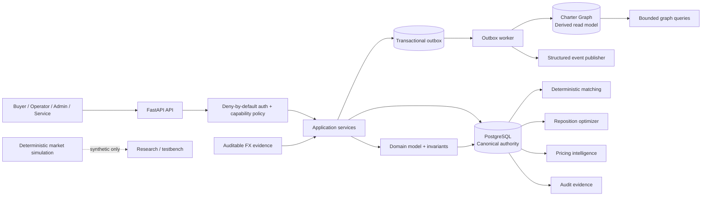
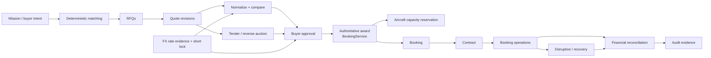

# CharterOS

[](https://github.com/SaridakisStamatisChristos/CharterOS/actions/workflows/ci.yml)


**CharterOS is a deterministic, auditable operating platform for B2B aviation charter procurement and operations.**

It models the charter lifecycle from buyer mission creation and supplier sourcing through RFQs, quotes, tenders, award, booking, contract, operations, disruption handling, financial reconciliation, audit evidence, and auditable FX. PostgreSQL remains the canonical source of transactional truth; graph, analytics, optimization, simulation, and evidence packages have deliberately narrower authority.

## What problem it solves

Aviation charter procurement is not only a search problem. A production-oriented system has to preserve commercial intent, supplier eligibility, aircraft continuity, bid confidentiality, exact pricing, approval authority, capacity commitment, operational changes, settlement evidence, and historical causality under concurrency and retries.

CharterOS separates those concerns so that recommendation, read models, analytics, and automation cannot silently become competing sources of truth.

## Implemented capabilities

| Area | Implemented capability |
| --- | --- |
| Catalog | Organizations, operators, airports, aircraft types and aircraft registration |
| Fleet state | Bitemporal position and availability history with explicit corrections |
| Missions | Buyer mission lifecycle and deterministic supplier/aircraft matching |
| Procurement | RFQs, immutable quote revisions, comparisons, tenders and buyer approvals |
| Award | Atomic quote award, booking creation, aircraft-capacity reservation and award-time feasibility revalidation |
| Contracts | Bilateral contract acceptance without rewriting original quote evidence |
| Operations | Booking lifecycle, disruption handling and replacement-aircraft feasibility |
| Reconciliation | Invoice revisions, disputes, variance approvals and final payable evidence |
| FX | Immutable bitemporal rate evidence and short-lived executable buyer FX locks |
| Charter Graph | Versioned event-derived read model with rebuild and verification |
| Optimization | Deterministic matching and exact reposition/deadhead optimization |
| Evidence | Deterministic evidence reconstruction and hash-chained PostgreSQL integrity streams |
| Security | Deny-by-default OIDC/JWT capability authorization and tenant-membership enforcement |
| Delivery | Transactional outbox with fenced leases, retry/poison handling and durable deduplication |
| Governance | Legal hold, tenant closure, dependency-aware erasure and privacy-safe export |
| Recovery | Read-only restored-state verification and graph rebuild verification |
| Supply chain | Locked dependencies, hardened container checks, SBOM and signed provenance/manifest evidence |
| Observability | Bounded-cardinality API, DB, award, outbox, graph, optimizer and evidence metrics |

## Architecture

CharterOS is intentionally a **modular monolith**: authoritative business transactions stay local and explicit, while workers, projections, queries, optimization and integration seams remain independently evolvable.



### Core code boundaries

| Path | Responsibility |
| --- | --- |
| `charteros/domain` | Aggregates, value objects, invariants, exact money/time rules |
| `charteros/application` | Use-case orchestration, ports and transactional workflows |
| `charteros/infrastructure` | SQLAlchemy persistence, outbox, graph storage and integrity integration |
| `charteros/matching` | Deterministic feasibility and ranking |
| `charteros/repositioning` | Reposition economics and exact assignment solver |
| `charteros/security` | Authentication identities, permissions and OIDC/JWT verification |
| `charteros/simulation` | Deterministic synthetic market scenarios |
| `charteros/pricing_intelligence` | Historical read-only pricing dataset construction |
| `charteros/shared` | Configuration, clock, logging and shared runtime primitives |
| `apps` | API, outbox worker, graph projection, cleanup, recovery and analysis CLIs |

See the [architecture atlas](docs/architecture/README.md), [authority and trust boundaries](docs/architecture/authority-and-trust-boundaries.md), [critical flows](docs/architecture/critical-flows.md), and [domain glossary](docs/glossary.md).

## Charter lifecycle



### Authority boundaries

- **Mission** owns buyer intent and sourcing lifecycle.
- **RFQ** is supplier-directed procurement evidence.
- **Quote** is immutable commercial revision evidence.
- **Tender** governs sealed multi-supplier competition where applicable.
- **ProcurementApproval** records a buyer decision before award; it is not award authority.
- **BookingService** is the canonical award serialization boundary.
- **Aircraft capacity reservations** are database-enforced commitments created with award and released only through eligible booking transitions.
- **Contract** records bilateral acceptance without rewriting the accepted quote.
- **Disruption** records post-booking operational changes without rewriting original procurement history.
- **FinancialReconciliation** records invoice/dispute/variance evidence; it does not claim payment settlement.
- **Charter Graph**, optimizer output, analytics and simulation are not command authority.

The aircraft-commitment chain is documented in [aircraft commitment assurance](docs/assurance/aircraft-commitment.md).

## Design invariants

1. **PostgreSQL is authoritative.** Derived graph, analytical and optimization state is rebuildable/advisory.
2. **Money is exact and currency is explicit.** Core pricing uses integer minor units; FX uses controlled `Decimal` arithmetic.
3. **Time is explicit.** Domain logic receives a `Clock`; event time, recorded time and validity intervals are distinct.
4. **Historical decisions are no-hindsight.** Evidence learned later is not visible at an earlier knowledge cutoff.
5. **Commercial lineage is immutable.** Revisions supersede; they do not rewrite history.
6. **Recommendation is not mutation.** Matching and optimization cannot silently commit business state.
7. **Ambiguity fails closed.** Missing FX, missing authorization, incomplete optimizer universes and unresolved commit outcomes do not invent success.

## Aircraft commitment and operational correctness

Capacity, award and disruption handling are one composed correctness boundary:

- PostgreSQL exclusion constraints prevent overlapping active reservations for the same aircraft.
- Eligible pre-confirmation booking termination releases its coupled reservation atomically.
- Replacement-aircraft feasibility reuses canonical matching policy and remains non-authoritative for capacity commitment.
- Reposition optimization fails closed when its bounded input universe is incomplete.
- Every award path revalidates the exact quoted aircraft immediately before committing capacity.

See ADRs [0027](docs/adr/0027-aircraft-capacity-reservations.md), [0028](docs/adr/0028-booking-termination-capacity-release.md), [0029](docs/adr/0029-replacement-aircraft-feasibility.md), [0030](docs/adr/0030-reposition-optimizer-universe-completeness.md), and [0031](docs/adr/0031-award-time-feasibility-truth-gate.md).

## Authentication and authorization

Every `/v1` route is protected by a centralized deny-by-default policy. Production authentication uses OIDC-compatible asymmetric JWT verification against configured HTTPS JWKS and validates algorithm, key ID, signature, issuer, audience, temporal claims, subject and CharterOS principal/permission claims.

`X-Buyer-Id` and `X-Operator-Id` are selectors, not authentication. A verified token may select only signed memberships unless an administrator has explicit tenant-administration capability.

Public runtime endpoints are `GET /health`, `GET /ready`, and `GET /metrics`. Production disables API docs/OpenAPI. If OIDC configuration is absent, protected routes fail closed.

For local authenticated evaluation without weakening the runtime boundary, see [EVALUATION.md](EVALUATION.md).

## Deterministic optimization

Matching produces explainable feasibility/ranking evidence rather than opaque learned authority. The reposition optimizer evaluates continuity-adjusted economics with deterministic tie semantics and does not auto-book.

The currently validated application/API envelope is 100 structural empty legs, 2,000 quoted future legs and approximately 200,000 dense candidate edges. Larger workloads are unvalidated rather than declared impossible. See [ADR 0018](docs/adr/0018-repositioning-deadhead-optimizer.md).

## Event delivery and Charter Graph

Domain mutations append canonical events in the same PostgreSQL transaction as business state. The outbox provides at-least-once delivery using stable event identity, aggregate-version causality, fenced leases, deterministic retries, poison quarantine and durable receipts.

The Charter Graph is a versioned PostgreSQL-backed read model. Rebuild verification independently reconstructs expected state from immutable event history and compares event counts, cursors, nodes/edges and a deterministic digest. Rebuilds never silently replace canonical business state.

```bash
make graph-status
make graph-rebuild
make graph-verify
```

## Quick start

### Requirements

- Python 3.13+
- PostgreSQL 17 recommended
- Docker + Docker Compose
- GNU Make optional
- `uv 0.12.21` for the pinned repository workflow

```bash
cp .env.example .env
python -m pip install "uv==0.12.21"
uv sync --frozen --extra dev
docker compose up -d postgres
uv run alembic upgrade head
uv run python -m apps.api
```

Development endpoints:

- `http://127.0.0.1:8000/health`
- `http://127.0.0.1:8000/ready`
- `http://127.0.0.1:8000/docs`

Protected `/v1` routes require configured OIDC/JWT identity. The [local evaluation kit](EVALUATION.md) generates an ephemeral loopback HTTPS identity service and short-lived test tokens while exercising the real authentication path.

After migrations, the hardened Compose services can be started with:

```bash
docker compose up --build api outbox-worker
```

## Testing and release evidence

Primary local checks:

```bash
uv lock --check
uv run python tools/check_supply_chain_policy.py
uv run ruff check .
uv run ruff format --check .
uv run mypy apps charteros tests tools
uv run bandit -q -r apps charteros tools
uv run pytest
```

GitHub Actions runs the full release gate on pull requests and pushes to `main`, including dependency policy/audit, migrations and schema drift, recovery/cleanup/observability checks, PostgreSQL integration tests, database restart recovery, deterministic solver benchmark, secret scanning, hardened container smoke, HIGH/CRITICAL fixable-vulnerability scanning, CycloneDX SBOM generation, signed build/SBOM attestations, canonical release-manifest construction and attestation verification.

Repository CI proves the build and verification chain. It does **not** by itself certify a live production deployment, infrastructure SLO attainment, backup-provider behavior, or external payment/accounting integration.

## Operations and documentation

- [Documentation index](docs/README.md)
- [Architecture](docs/architecture/README.md)
- [Assurance evidence](docs/assurance/README.md)
- [Authentication and authorization](docs/authentication-authorization.md)
- [Evidence integrity](docs/evidence-integrity.md)
- [Runbooks](docs/runbooks/)
- [ADRs](docs/adr/)

Operational commands include the outbox worker, graph rebuild/verification, bounded resource cleanup, recovery verification and restricted PostgreSQL runtime-role provisioning. Detailed procedures live in the linked runbooks instead of the product overview.

## Current boundaries

CharterOS currently does **not** claim:

- generic exactly-once external side effects;
- payment-rail settlement or accounting-ledger posting;
- autonomous ML authority for matching or award;
- provider-independent backup/PITR creation;
- live production SLO attainment from repository CI alone;
- that optimizer workloads beyond the validated envelope are production-qualified;
- that derived graph, analytics, simulation or evidence packages are transactional authority.

Roadmap work must remain clearly separate from implemented capability and does not become a product claim until code and verification evidence exist.

## Repository layout

```text
apps/                    Runtime entry points and operational CLIs
charteros/               Domain, application and infrastructure implementation
deploy/                   Deployment/runtime-role assets
docs/                     Architecture, ADRs, assurance and runbooks
migrations/               Alembic schema history
tests/                    Unit and PostgreSQL-backed integration tests
tools/                    Verification, benchmark, load and release-evidence utilities
EVALUATION.md             Authenticated local product walkthrough
```

## License

CharterOS is distributed under the **CharterOS Proprietary License v1.0** in [LICENSE](LICENSE). Public source visibility does not grant open-source rights; use, redistribution and commercial rights are governed by that license.
